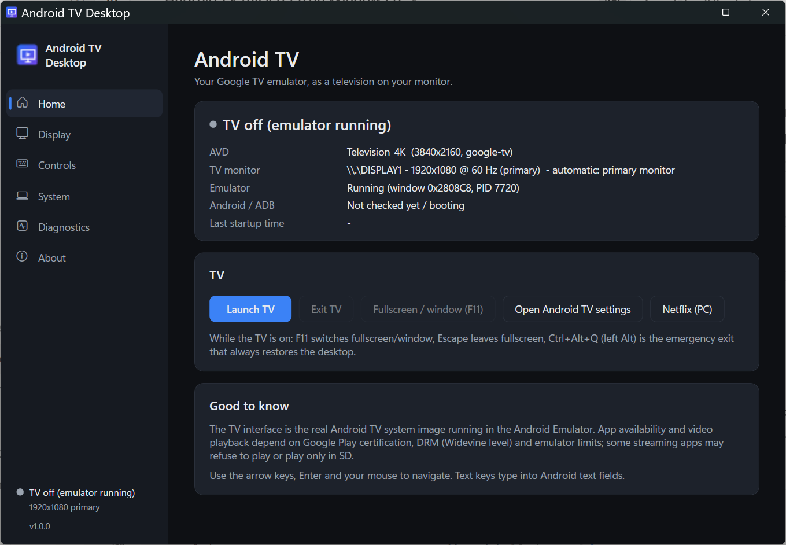
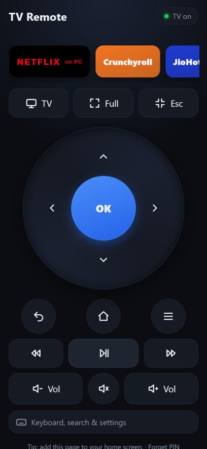

# Android TV Desktop

**Turn the Android Studio emulator into a real-feeling TV on your Windows PC.** One click starts your
Google TV / Android TV emulator and shows it **borderless and fullscreen** on the monitor you choose. No desktop,
taskbar or emulator chrome is visible, and you can always get back to Windows with one key. Control it with
the keyboard, the mouse, or your **phone as a remote**.

> This app does not fake a TV interface. The real Android Emulator and the real Android TV / Google TV system
> image do the rendering; Android TV Desktop is the launcher and controller around them.

<p>
  
  
</p>

## Features

- **Launch TV:** starts (or reuses) your Android TV AVD, waits for Android to boot, and goes fullscreen.
  - The fullscreen is **verified on screen** (pixels and window z-order), not just assumed from a window size.
  - The TV bezel/device frame is removed; your AVD is never modified.
- **Any monitor:**
  - Auto (primary monitor) or a monitor you pick: 1080p, 1440p, 4K, any DPI scaling.
  - It follows monitor plug/unplug and resolution changes.
  - It shows each monitor's refresh rate and HDR capability.
- **Keys:**
  - **F11** switches fullscreen/window.
  - **Esc** leaves fullscreen.
  - **Ctrl+Left Alt+Q** is the emergency exit that always restores the desktop.
  - **Backspace** = Android Back and **Home** = Android Home (both configurable).
  - Arrows, Enter and typing go straight to the TV.
- **Mouse:** click, move and scroll go to the TV; right-click can be set to Android Back.
- **Phone remote** (web page, no app needed; PIN protected):
  - D-pad, OK, Back, Home, media and volume buttons, and typing.
  - App tiles for your installed TV apps (YouTube, Prime Video, Crunchyroll, JioHotstar…).
  - **Netflix on the PC**.
  - Fullscreen / Esc / TV buttons.
- **Netflix (PC):** Netflix doesn't run in the emulator, so one click opens netflix.com fullscreen in Microsoft
  Edge on the TV monitor instead. The phone remote controls it too.
- **Android display resolution:** optional 1080p / 1440p / 4K / match-monitor setting, done through ADB
  (`wm size`); it's reversible.
- **Runs in the tray:** the phone remote keeps working after you close the window. It can optionally start
  hidden at Windows sign-in.
- **Safe by design:**
  - The desktop is restored on every exit path, including after a crash on the next start.
  - There's an emergency `Restore-Desktop.bat`.
  - No admin rights, no registry changes, no telemetry.
- **Diagnostics:** log with rotation, a troubleshooting page, network/ADB checks, and a diagnostics export.

## Requirements

| | |
|---|---|
| Windows | Windows 10 or 11, 64-bit (.NET Framework 4.8 is built in) |
| Android Studio | With the Android Emulator and SDK Platform-Tools (ADB) installed |
| An Android TV AVD | Created in Android Studio (see below). A **Google TV** image with Play Store is recommended |
| RAM | 8 GB minimum (the emulator itself uses 2–4 GB). Close other heavy apps if the emulator stalls |
| Optional | Microsoft Edge (for Netflix (PC)) |

### Create the TV emulator (one time)

1. Android Studio → **Device Manager** → **Create Virtual Device**.
2. Category **TV** → choose a TV device (e.g. *Television (1080p)* or *Television (4K)*).
3. Pick a **Google TV** or **Android TV** system image and download it.
4. Finish, and start it once from Android Studio to make sure it boots. Sign in to your Google account on
   the TV if you want the Play Store.

Android TV Desktop finds the SDK automatically (`ANDROID_SDK_ROOT`, `ANDROID_HOME` or
`%LOCALAPPDATA%\Android\Sdk`). It also picks your TV AVD automatically; you can change it on the
**System** page.

## Install

1. Download the latest **`AndroidTVDesktop-x.y.z.zip`** from
   [Releases](../../releases) and extract it.
2. Run **`install.bat`**. It installs for your user only, into `%LOCALAPPDATA%\Programs\Android TV Desktop`,
   and adds Desktop and Start Menu shortcuts.
3. Start **Android TV Desktop** and press **Launch TV**.

Windows SmartScreen may warn about an unsigned app from the internet: choose *More info → Run anyway*,
or build it yourself (below).

Uninstall from the Start Menu (*Uninstall Android TV Desktop*). It removes only what the installer created;
your emulator and AVD are never touched.

## Using it

| | |
|---|---|
| **Launch TV** | Start/reuse the emulator, wait for Android, go fullscreen on the selected monitor |
| **F11** | Fullscreen ⇄ window (while the TV has focus) |
| **Esc** | Leave fullscreen (otherwise Esc goes to Android as Back) |
| **Ctrl + Left Alt + Q** | Emergency exit from any app: leaves TV mode and restores the desktop |
| **Exit TV** | Back to the normal desktop; the emulator keeps running |
| **Netflix (PC)** | Netflix fullscreen in Edge on the TV monitor (press F11 or hold Esc to leave) |

### Phone remote

1. **Controls → Phone remote → Enable.** The app shows an address such as `http://192.168.1.20:8765` and
   a 6-digit **PIN**.
2. Click **Allow through Windows Firewall…** once. Windows asks for admin approval. The rule only allows
   devices on your local network.
3. On your phone (same Wi-Fi), open the address, enter the PIN and use **Add to Home screen**.

While **Netflix (PC)** is in front, the remote controls Netflix in Edge:

| Button | Netflix action |
|---|---|
| OK | Enter |
| play/pause | Space |
| arrows | seek / player volume |
| volume | Windows volume |
| text box | Netflix search |

**TV** brings the Android TV back.

> The Google TV phone app's remote can't pair with an emulator: emulator images don't include the Android TV
> Remote Service, and the emulator sits on a private network. That's why this app has its own remote.

### Keep it running

- Closing the window hides the app to the **tray** (next to the clock), so the phone remote keeps working.
  Right-click the tray icon → **Exit** to quit.
- **System → When I sign in to Windows:** *Do nothing*, *Start in the background (phone remote ready)*, or
  *Start the TV*.

## What works in an emulator (and what doesn't)

- **Apps:** Google TV apps from the Play Store mostly work (YouTube, Prime Video, Crunchyroll, JioHotstar,
  Spotify, VLC…). Availability depends on Google Play certification and DRM.
- **Netflix:** the TV app is *not* offered for emulators ("device isn't compatible"); use **Netflix (PC)**.
- **HDR:** the emulator renders SDR, even on an HDR monitor.
- **Bluetooth:** the emulator's Bluetooth is virtual and can't see real devices. Pair headphones, speakers,
  keyboards and mice with **Windows**; TV sound plays through your Windows audio output.
- **Play Store says "Authentication is required":** the emulator clock is usually wrong after a Quick Boot
  snapshot. Cold boot it once: Android Studio → Device Manager → ⋮ → *Cold Boot Now*.

## Troubleshooting

| Problem | Fix |
|---|---|
| Screen stuck on the TV | **Ctrl + Left Alt + Q**. Or Start Menu → *Restore desktop (emergency)*, or run `Restore-Desktop.bat` |
| "window did not appear within 240 s" | The emulator didn't start, often from low RAM. Close other apps; check that the AVD boots from Android Studio |
| TV shows a bezel | The emulator was started from Android Studio. Close it and use **Launch TV** |
| Phone can't open the remote | Same Wi-Fi? Remote enabled? Firewall allowed? Some public or hotel Wi-Fi blocks devices from seeing each other |
| No network inside Android | **System → Check network** (Windows online → Android internet → DNS → clock) |

Logs: `%LOCALAPPDATA%\AndroidTVDesktop\logs\app.log`. Settings: `%APPDATA%\AndroidTVDesktop\settings.json`.
**Diagnostics → Export diagnostics** zips both; nothing is uploaded anywhere.

## Build from source

Requirements: Visual Studio 2019+ or **Build Tools for Visual Studio** (C# compiler), and the
**.NET Framework 4.8 Developer Pack**. No NuGet packages and no .NET SDK are needed.

```powershell
powershell -ExecutionPolicy Bypass -File build.ps1      # build + run the unit tests -> build\bin\
powershell -ExecutionPolicy Bypass -File publish.ps1    # build + dist\AndroidTVDesktop-<version>.zip
```

```
src/Core/        engine: emulator/ADB, fullscreen + verification, monitors/HDR, keys, phone remote, settings, logs
src/App/         WPF app (UI built in C#, dark theme), tray, entry point
tests/           unit tests (dependency-free runner) and live GUI acceptance tests (tests/gui)
installer/       per-user install / uninstall scripts
docs/            PRD, TRD (technical design), App flow, Design, Rules, Memory, test results
tools/           icon generator, read-only window diagnostics
```

`tests/gui/Check-TvScreen.ps1` is a read-only checker: it measures whether the TV really covers the monitor and saves a
screenshot. The full live GUI test harness, which sends synthetic keystrokes, is not published, because antivirus software
flags that kind of script.

See [`docs/TRD.md`](docs/TRD.md) for how fullscreen works. It explains why a simple "resize to the monitor"
fails with the emulator: Qt paints the picture inset and re-applies its own window mask.

## Privacy and safety

- No telemetry. The only network use is the user-started checks (ping/ADB), the phone-remote server on your
  local network (off by default, PIN protected), and Edge opening netflix.com when you ask.
- No admin rights, except the optional firewall rule, which you approve. No registry changes, and no changes
  to the Windows shell, HDR or display settings.
- Never wipes, edits or resets your AVD.

## License

[MIT](LICENSE)
